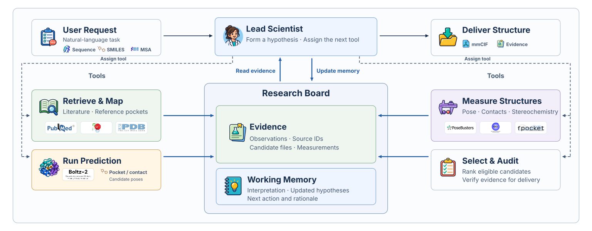

# PoseEvidence

A training-free scientific agent for protein–ligand structure prediction with frozen Boltz-2.

PoseEvidence retrieves literature and reference-structure evidence, maps relevant residues, and uses these observations to plan explicit `pocket` or `contact` conditions. It then predicts structures, measures the candidates, and updates a versioned research board before deciding whether to run another round or deliver an mmCIF.


The agent keeps tool measurements separate from hypotheses and decisions. Experimental target structures are reserved for offline evaluation. Boltz confidence, physical checks, and experimental agreement are reported as different quantities.

[Research presentation and interactive case study](https://losewords.github.io/pose-evidence/)

## Run locally

The prediction worker targets Linux with an NVIDIA GPU. The code was exercised with Python 3.10 and Boltz 2.2.1. Follow the [Boltz installation guide](https://github.com/jwohlwend/boltz#installation) for your CUDA setup.

```sh
python3.10 -m venv .venv
. .venv/bin/activate
python -m pip install -r requirements.txt
export TETRA_GPU_INDEX=0
```

Set `OPENROUTER_API_KEY` in your environment, or point `OPENROUTER_API_KEY_FILE` at a key file outside this checkout. The default model is `deepseek/deepseek-v4-flash` and `TETRA_LLM_MODEL` overrides it. For native DeepSeek, set `TETRA_LLM_PROVIDER=deepseek` and configure `DEEPSEEK_API_KEY` or `DEEPSEEK_API_KEY_FILE`.

Create a request JSON with an explicit `goal` and `input`. The placeholders below stand for your actual protein sequence, stereochemical ligand SMILES, and a precomputed MSA path.

```json
{
  "goal": "Predict the supplied protein–ligand complex. Use literature evidence to decide whether a binding-site condition is warranted and deliver one primary mmCIF.",
  "input": {
    "sequence": "<protein sequence>",
    "smiles": "<isomeric ligand SMILES>",
    "msa": "/path/to/input.a3m"
  }
}
```

```sh
python -m tetra.scientific_agent --state state-research run request.json --literature --max-steps 24
python -m tetra.scientific_agent --state state-research status SESSION_ID
python -m tetra.scientific_agent --state state-research resume SESSION_ID
```

When the agent reports `waiting_prediction`, let the background worker finish and then resume the same session. The output directory contains the job artifacts, candidate structures, evidence, and versioned memory. The literature route queries public services and may send the input protein sequence to RCSB. If an MSA is omitted, the prediction backend can send the sequence to the configured MSA service.

The standard path uses PoseBusters for physical checks. `TETRA_ASSESS_PYTHON` can select a separate worker interpreter. OpenMM refinement, GNINA, fpocket, and OpenStructure scoring are advanced paths that require local installation and, where enforced by the code, validated tool records. Benchmark runners are separate from the standard agent command. Set `TETRA_GPU_LOCK_DIR` explicitly when sibling checkouts use the same GPUs.

## Code map

| Package | Responsibility |
| --- | --- |
| `tetra/orchestration/` | Agent loops, tool routing, retrieval readiness, and prompts |
| `tetra/research/` | Literature and structure retrieval, mapped evidence, hypotheses, and working memory |
| `tetra/prediction/` | Experiment registration, constraints, Boltz jobs, and GPU locking |
| `tetra/evaluation/` | Reference-free structure checks, pose comparison, refinement, selection, and mmCIF delivery |
| `tetra/benchmarks/` | Offline runners and scoring against experimental structures |
| `tetra/runtime/` | Provider clients, I/O, persistence, and cost accounting |

Existing command-line module names remain entry points. The GPU worker uses lock files in the local `state/` directory, or in the directory selected by `TETRA_GPU_LOCK_DIR`.

## Offline tests

```sh
python -m unittest discover -s tests -q
```

The unit suite uses mocks for model and network calls. Two tests that expect a prior local Boltz run skip when its artifacts are absent.
